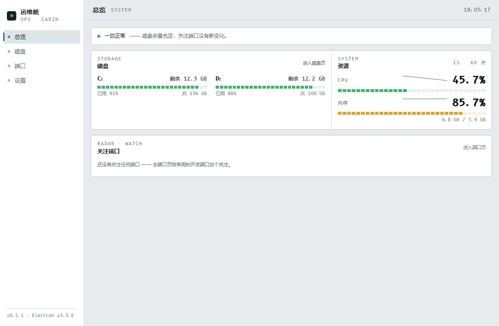
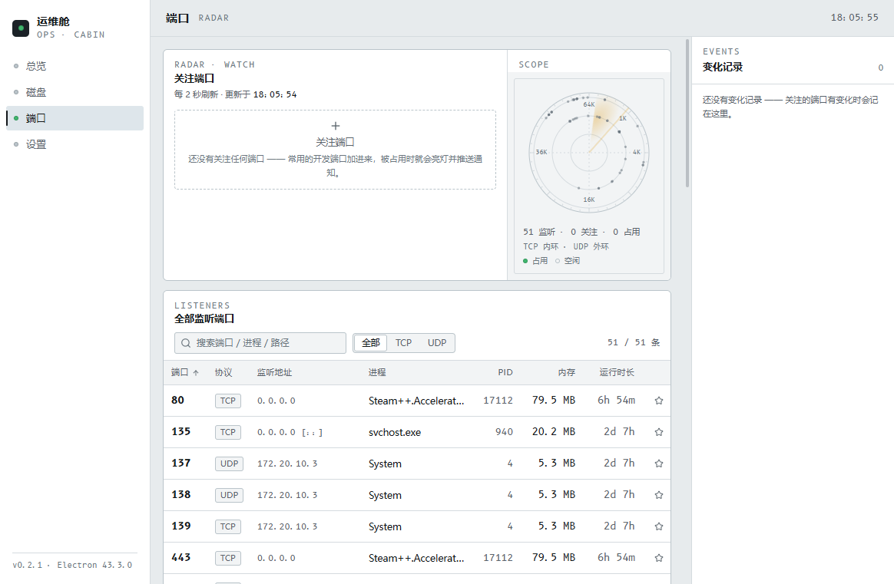
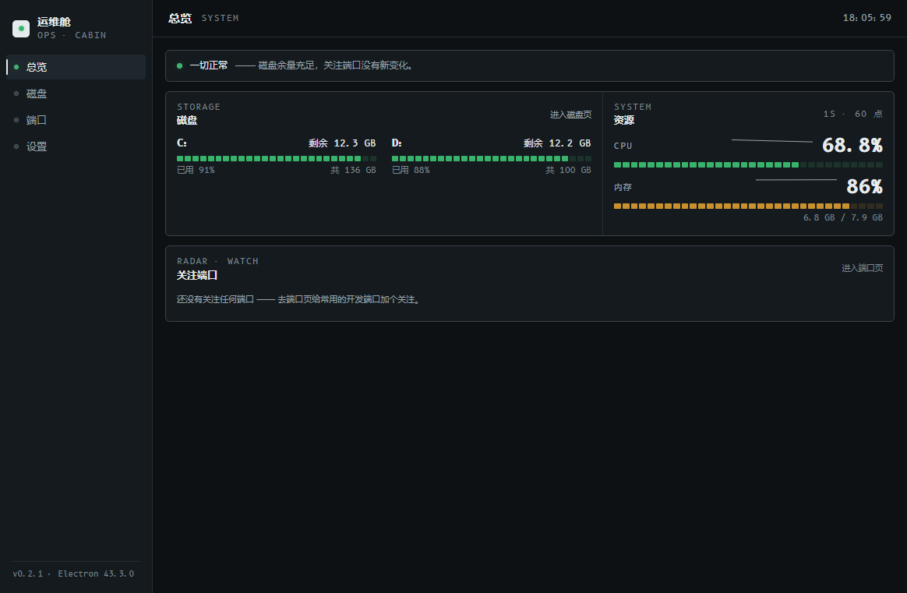

# 运维舱 · Ops Cabin

> Windows 本机运维台：**一屏看系统状况，扫描并清理磁盘垃圾，盯着你关心的端口。**

[](https://github.com/FightZhanAng/ops-cabin/releases/latest)
[](LICENSE)



## 功能

| 页面 | 干什么 |
|------|--------|
| **总览** | 信号条（异常才亮灯）、磁盘分区读数、CPU / 内存小数表、关注端口一览；每一格都是入口 |
| **磁盘** | 扫描「安全清理 / 开发缓存 / 大文件」→ 勾选 → 预览 → 清理；详情面板给路径与风险，可打开所在目录 |
| **端口** | **端口雷达**（关注端口亮灯，琥珀扫描线一圈 4.5s）+ 全部监听端口表（搜索 / 协议筛选 / 排序）+ 变化记录；可看进程详情、结束进程 |
| **设置** | 主题（浅色 / 跟随系统 / 深色）、端口变化通知、白名单、清理计划、更新、危险区 |




## 下载与安装

到 [Releases](https://github.com/FightZhanAng/ops-cabin/releases/latest) 下载：

- `ops-cabin-x.y.z-setup.exe` —— 安装版（可改安装目录、建桌面快捷方式），**支持应用内自动更新**
- `ops-cabin-x.y.z-portable.exe` —— 免安装版（双击即用；更新请回下载页手动替换）

> 安装包未做代码签名，Windows SmartScreen 可能提示「未知发布者」：点「更多信息 → 仍要运行」。

## 磁盘清理安全吗

三道防线，任何一道拦下就不动：

1. **只删「本次扫描结果里、且被你勾选」的路径**（伪造路径会被清理器拒绝）；
2. **白名单**（设置页维护的保护目录）在扫描与清理时一律跳过；
3. **系统保护名单**（系统目录、程序目录等）同样跳过。

默认删除进**回收站**（可还原）；「永久删除」只在你明确选择时使用。

## 端口雷达怎么用

- 点监听表里的 ★ 或在关注区添加端口；被占用 / 被释放 / 换了占用者时，雷达亮灯并记入变化记录；
- 打开「端口变化通知」后，变化会推 Windows 系统通知；
- 「清理计划」按日 / 按周自动扫描（只扫不删），完成后发通知。

## 开发

```bash
pnpm install     # 依赖安装（国内网络可参考 .npmrc 里的 Electron 镜像设置）
pnpm dev         # 开发模式（Electron + Vite HMR）
pnpm typecheck   # 类型检查
pnpm build       # 构建主进程与渲染层产物
pnpm dist        # 出 Windows 安装包（release/ 目录）
```

技术栈：Electron 43 · electron-vite · React 19 · TypeScript · Tailwind CSS v4 · Radix UI。

**测试**：十套端到端脚本在 `scripts/`（真实开窗口、驱动界面、断言 DOM 与 IPC），每套自带构建：

```bash
node scripts/e2e-check.mjs     # 主进程地基：窗口位置恢复 / 托盘 / 设置原子落盘
node scripts/e2e-scan.mjs      # 扫描引擎：大目录 / 取消 / 进度 / 白名单
node scripts/e2e-disk.mjs      # 磁盘页闭环：扫描 → 勾选 → 清理 → 回收站
node scripts/e2e-ports.mjs     # 端口采集：与外部 netstat 交叉比对
node scripts/e2e-ports-m5.mjs  # 端口页闭环：关注 / 变化检测 / 进程处置
node scripts/e2e-overview.mjs  # 总览页：指标推送与走势线
node scripts/e2e-settings.mjs  # 设置页：主题即时生效 / 白名单 / 计划 / 危险区
node scripts/e2e-update.mjs    # 更新流程（离线假版本驱动，不联网）
node scripts/e2e-smoke.mjs     # 冒烟：四页 × 深浅两轮，截图留档
node scripts/e2e-portable.mjs  # 打包产物验证（需先 pnpm dist）
```

## 设计

界面是一台「仪表」，不是一块「仪表盘」：颜色是信号不是装饰（绿 / 黄 / 红只表状态，且必配文字）；
数据一律等宽字体右对齐成列——内嵌 [B612 Mono](https://github.com/polarsys/b612)（空客为驾驶舱显示屏
委托设计的字体，这也是「舱」的字面来源）；分区用 1px 发丝线拼合成整板而非漂浮卡片。
设计系统与逐页规范见 [`design-system/`](design-system/opscabin/MASTER.md)。

## 隐私

扫描结果、关注清单、设置全部存在本机。应用**除「检查更新」外不联网**。

## 许可

[MIT](LICENSE) © 2026 FightZhanAng。随应用分发的第三方组件与内嵌字体的完整声明见
[THIRD-PARTY-NOTICES.md](THIRD-PARTY-NOTICES.md)（B612 Mono 为 SIL OFL 1.1）。
